# 鱼鱼API · yuyu-app

<p align="center">
  <b>sub.anzhiyu.com 的非官方多端客户端 · Android + Windows</b><br/>
  余额、消耗、密钥、通道健康、订阅、榜单、日志，两端同步；
  安卓端是原生 App，桌面端是 Electron 应用，共用同一套接口和同一套视觉语言。
</p>

> 个人自用项目，非官方出品。只读写你自己账号的数据。

**这个仓库只发布安装包，不包含源码。**

## 下载

到 [Releases](../../releases) 取最新版本：

| 文件 | 平台 | 说明 |
|---|---|---|
| `yuyu-console-1.1.6-x64-setup.exe` | Windows x64 | 122.9 MB · 安装版，可选安装目录，自动建快捷方式，卸载保留登录状态 |
| `yuyu-console-1.1.6-x64-portable.exe` | Windows x64 | 111.5 MB · 免安装单文件，双击即用，可放 U 盘 |
| `yuyu-api-1.1.6.apk` | Android | 76.6 MB · 原生 APK，Android 8.0 以上；含 arm64-v8a / armeabi-v7a / x86_64 |

安装提示：

- **Windows**：包未做代码签名，首次运行 SmartScreen 会提示「未知发布者」，选 **更多信息 → 仍要运行** 即可
- **Android**：APK 为自签名，安装时需允许「安装未知来源应用」

## 这是什么

站点只提供网页后台。这套客户端用官方 API 重做了一遍，把这套后台在手机和桌面上各自该有的样子补全。

|  | Android | Windows |
|---|---|---|
| 技术 | Expo SDK 58 · React Native 0.88 | Electron 45 · React 19 · Vite 7 |
| 形态 | 原生 App，底部标签 | 无边框窗口，侧栏导航，托盘常驻 |
| 当前版本 | 1.1.6 | 1.1.6 |

两端共有的能力：

- **消耗看得懂**：今日花掉多少、钱花在哪个模型、缓存省了多少、按日走势
- **密钥能管**：启停、改名、复制、额度与分组，桌面端额外有按键消耗分布和按日用量
- **通道状态**：可用率、成功率、缓存率、延迟曲线，异常通道置顶，单通道时间线与失败点
- **质检结果**：服务端每次跑完的模型输出，可直接看到渲染后的 HTML 动画
- **扫码充值**：下单后出二维码，微信/支付宝扫码即可，轮询自动到账
- **订阅与榜单**：额度进度、用尽预估、邀请返利、全站排行
- **更新提醒**：启动即比对 GitHub Releases 的最新版本，有新版本才提示，可关闭；关闭只对本次运行有效，下次进来照常提醒。设置 / 关于页另有手动检查
- **公告**：启动只弹未读公告，弹窗可关闭或「不再提示」；读过的不再打扰

桌面端多做的部分：常驻托盘（关窗口不退出，只有托盘菜单的「退出」才真正结束进程）、
无边框可拖拽标题栏（登录前也有关闭按钮）、可翻页的数据表格、弹窗详情、
键盘可达的表单、按密钥统计的真实消耗。

## 界面

### Windows

| 登录 | 概览 | 用量 |
|---|---|---|
| 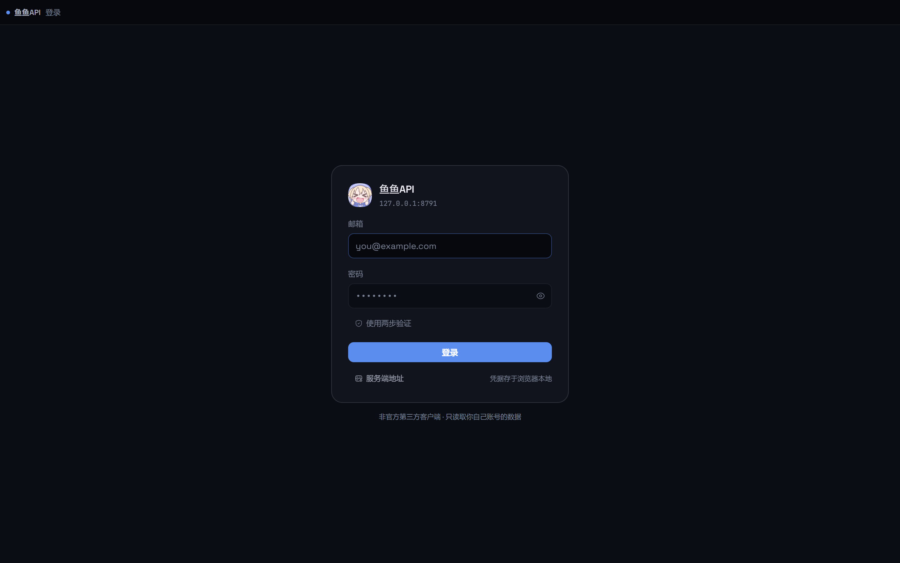 | 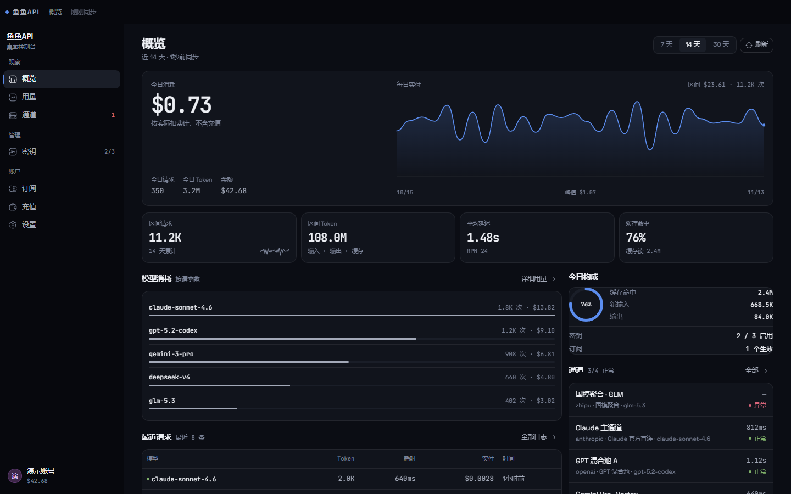 | 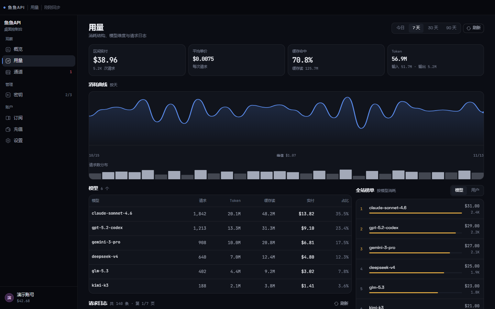 |

| 通道 | 充值 | 订阅 |
|---|---|---|
| 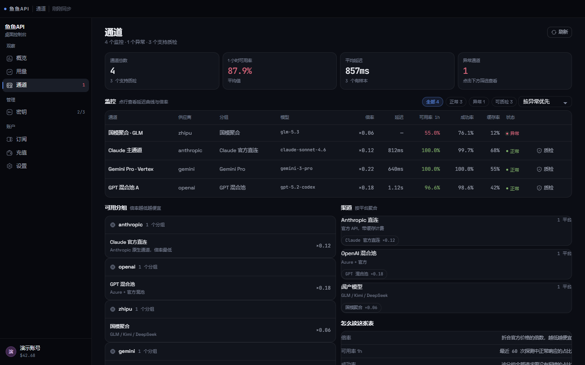 | 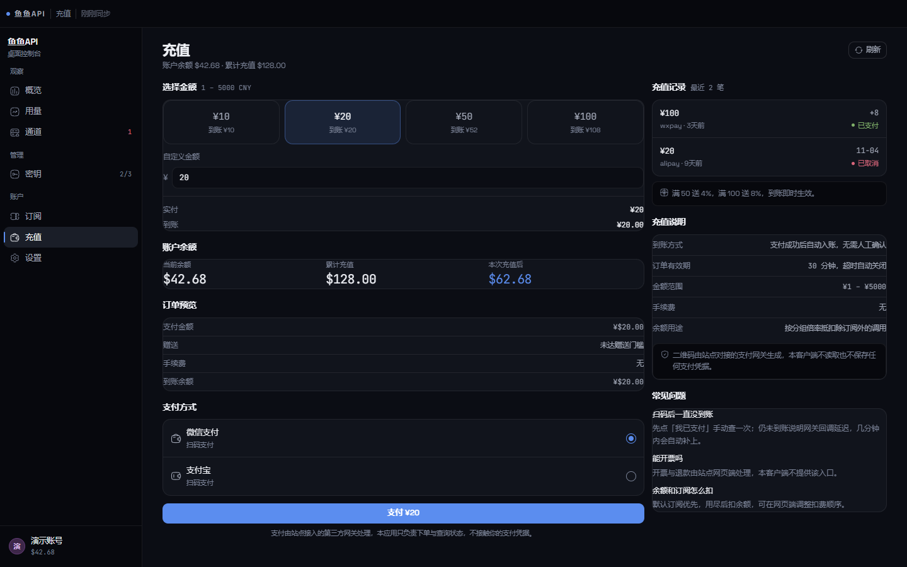 | 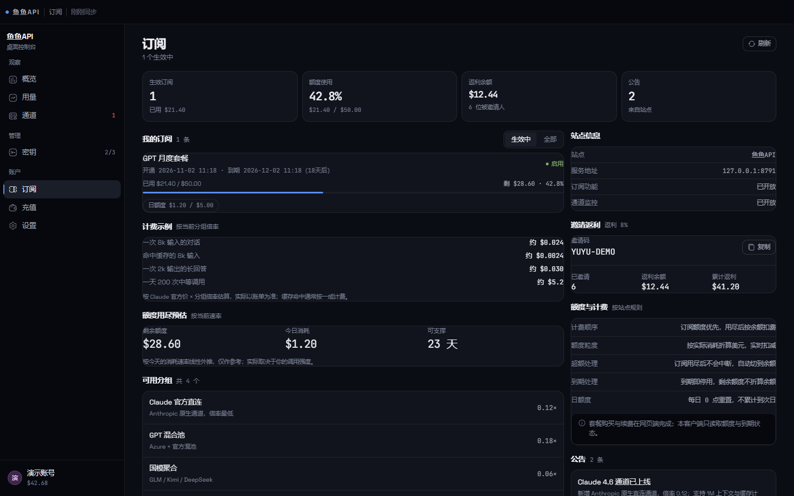 |

| 设置 | 公告弹窗 | 公告入口 |
|---|---|---|
| 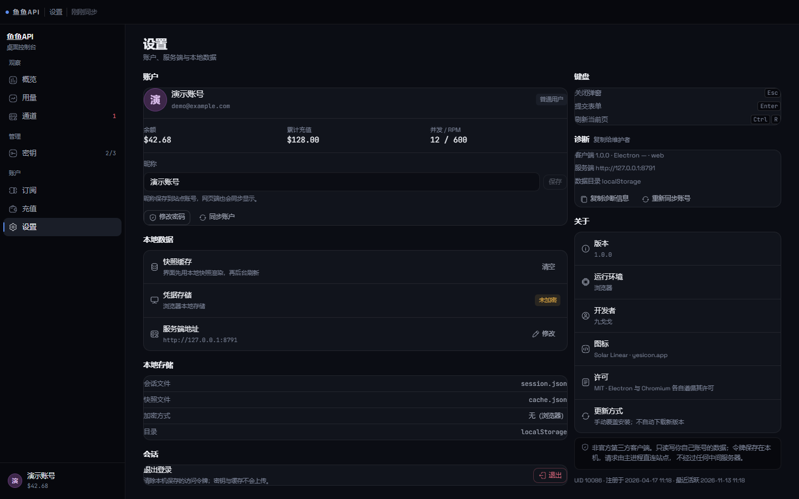 | 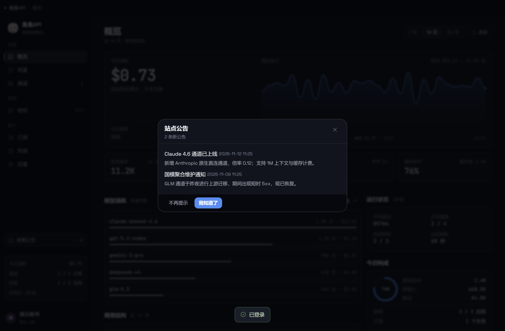 | 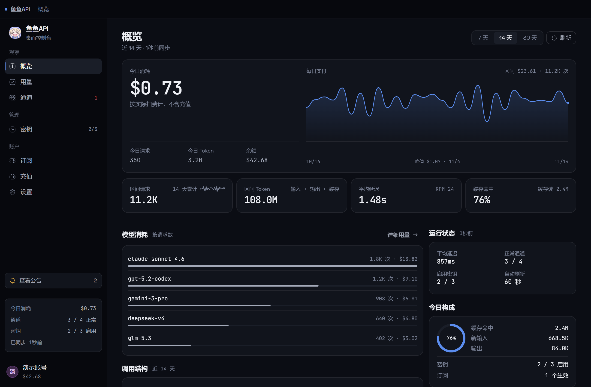 |

### Android

| 登录 | 概览 | 用量 |
|---|---|---|
| 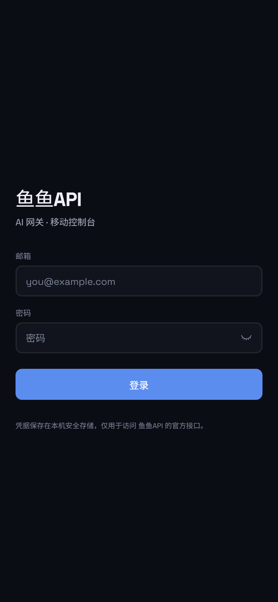 | 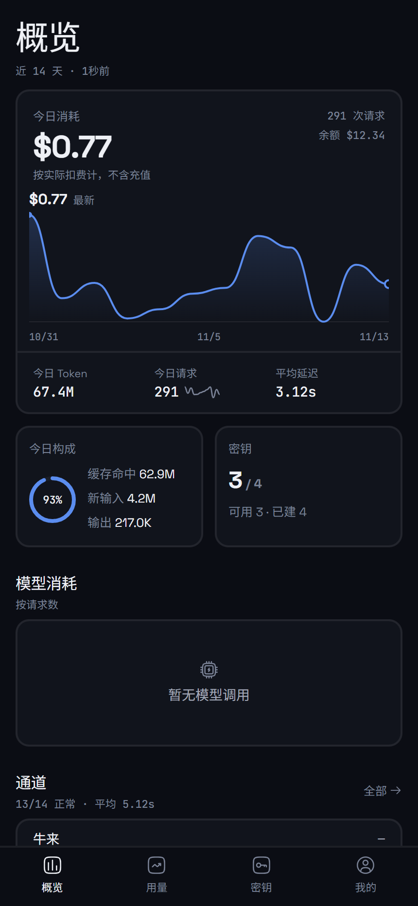 | 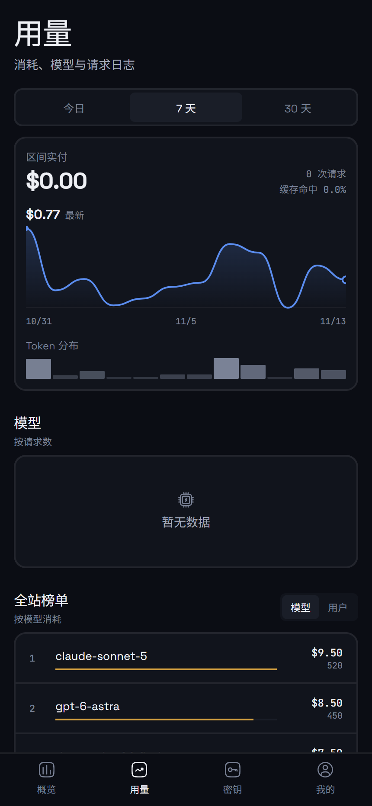 |

| 密钥 | 我的 | 通道 |
|---|---|---|
| 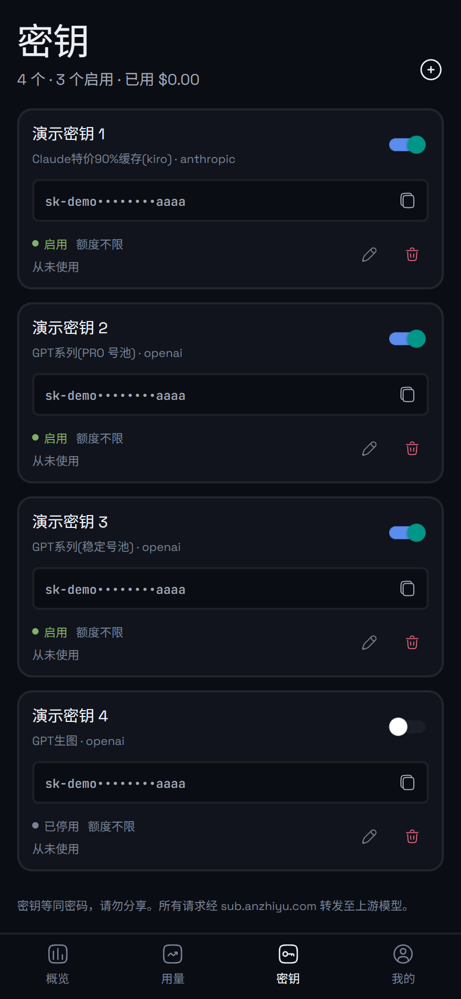 | 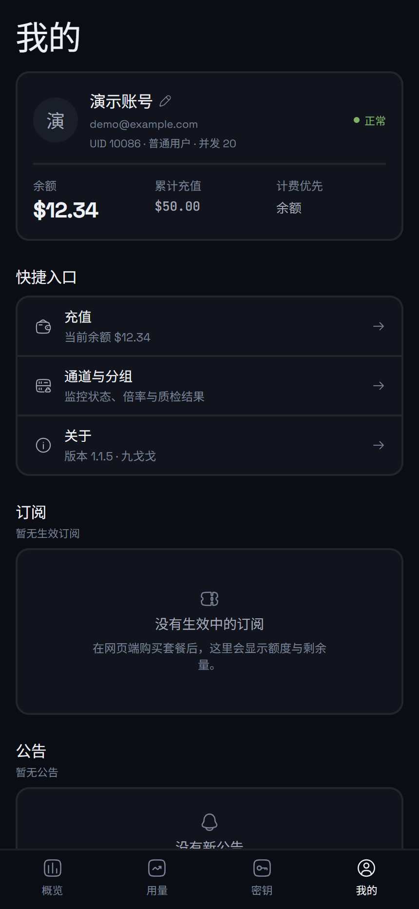 | 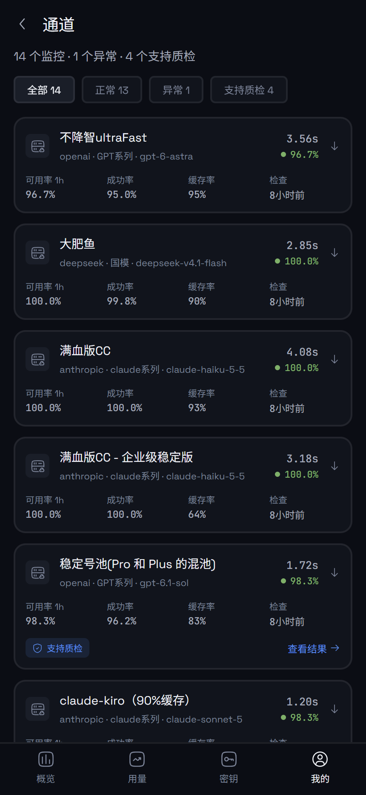 |

| 质检结果（HTML 直接渲染） | 公告弹窗 |
|---|---|
| 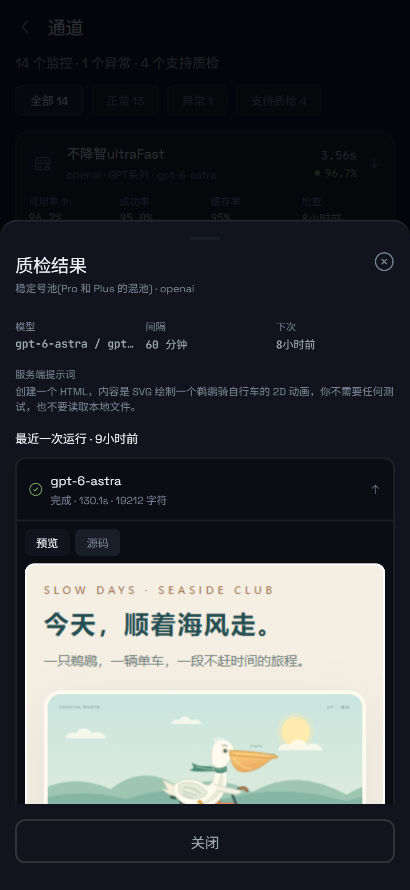 | 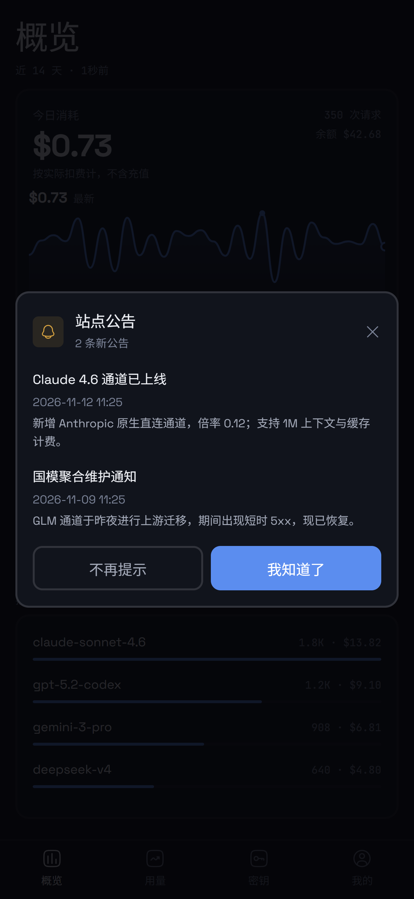 |

> 截图使用演示账号（`demo@example.com`）与本地 fixture 接口，不含任何真实账号数据。

## 校验和

每个 Release 的正文里都附了当次产物的 SHA-256。下载后可以这样核对：

```bash
# Windows
certutil -hashfile yuyu-console-1.1.6-x64-setup.exe SHA256

# macOS / Linux
sha256sum yuyu-api-1.1.6.apk
```

## 版本历史

| 版本 | 要点 |
|---|---|
| [1.1.6](docs/releases/v1.1.6.md) | 启动即检测更新（关闭只对本次有效）、公告只弹未读；桌面端曲线补日期轴与带日期的峰值、请求日志修正密钥与 Token 列、通道角标统一数据源；安卓端折线可点选单日、检查更新改为按钮、启动闪屏改纯色 |
| 1.1.5 | 首个正式版：Android 与 Windows 双端同时发布 |

## 关于本仓库

这个仓库只存放发布产物与说明，源码不在此公开。
README、截图与 Release 正文随源码仓库的版本更新同步。

## 免责声明

本项目为个人自用工具，与 sub.anzhiyu.com 官方无关，未获其背书。

使用前请确认这符合你与站点之间的服务条款。作者不对因使用本软件造成的任何损失负责。
客户端只读写你自己账号的数据，凭据保存在本机（Android Keystore / Windows DPAPI），不上传。

## License

只分发编译后的可执行文件，未授予再分发或修改的权利。
